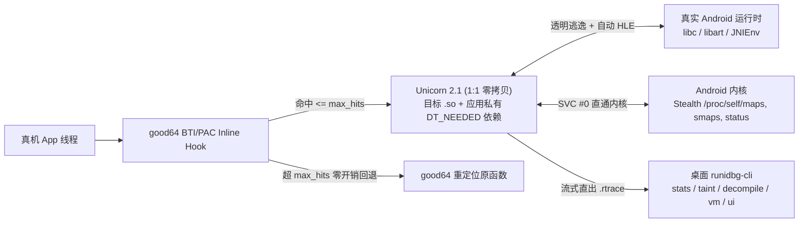

<div align="center">

# runidbg

**纯 Rust 打造的高性能 Android ARM64 `.so` 仿真器、二进制 Tracer、污点分析与时间旅行逆向引擎**

`Rust + unidbg + ... = runidbg`

<p>
  <a href="https://github.com/tiwe0/runidbg/releases/latest"></a>
  
  
  
  
</p>

<p>
  <strong>简体中文</strong> &nbsp;·&nbsp;
  <a href="./README_EN.md">English</a> &nbsp;·&nbsp;
  <a href="./docs/GUIDE.md">完整使用指南</a> &nbsp;·&nbsp;
  <a href="./docs/SKILL.md">AI Agent Skill</a> &nbsp;·&nbsp;
  <a href="https://github.com/tiwe0/runidbg/releases">预编译下载</a>
</p>

<br />

<picture>
  <source media="(prefers-color-scheme: dark)" srcset="./docs/assets/runidbg-features-zh-dark.png" />
  <source media="(prefers-color-scheme: light)" srcset="./docs/assets/runidbg-features-zh-light.png" />
  
</picture>

</div>

<br />

## Highlights

- **纯 Rust 零 JVM 高性能** — `77 ms` 冷启动（`22.6×`）、`21.7 MB` 单实例内存（省 `82%`），单文件跨平台分发。
- **Zygisk 进程内 1:1 零拷贝混合 Trace (`runidbg-zygisk`, v0.5.0)** — 仅 **1.3 MB** 刷入包（支持 Magisk / KernelSU / APatch Zygisk API v4，16KB 页对齐），将真机 App 指定 `.so` 及其应用私有 `DT_NEEDED` 依赖（含 Split APK）动态切入 Unicorn 2.1 `arch_aarch64`，而 `libc`/`libart`/`JNIEnv`/内核 `SVC #0` 透明逃逸至真实 Android 运行时（免补环境、零 C++ Dobby 依赖、纯 Rust `good64` BTI/PAC Inline Hook + Shadow Pristine Page 绕过 `.text` 自校验 + 独立 ShadowCallStack `X18` + 可选 `/proc/self/maps|smaps|status` Stealth 过滤 + Root Companion 流式直出 `.rtrace`）。
- **四引擎 ARM64 后端** — `Unicorn 2.1`（全功能 Trace / Hook / GDB）与 `Dynarmic JIT` / `Linux KVM` / `macOS Hypervisor`（纯算最高 `480×`）统一接口切换。
- **完整 Android 原生运行时** — ELF 动态链接、`110+` HLE、合并空闲链堆、JNI 1.6、APK 内存直载、`DeviceProfile` 真机画像、隔离双流 RNG 与离线护栏 Socket/epoll。
- **零拷贝 Tracer、单文件 `.rtrace`、轻量污点与 `decompile` v2** — `17.03M insns/s` 双流 `.idx/.ext`（统一记录 HLE 内存/熵源/时钟事件 + 缺失 `.ext` 显式告警），支持 **`pack`/`unpack` 打包单文件 Deflate 压缩 `.rtrace` 归档（全离线命令/UI/JS/MCP 透明免解包直读）**；纯 Rust 字节级前向/反向污点切片（`--from-seq` / `--stop-at-pc` / `--stop-mem` 手术刀截断与熵源标注）；**`decompile` v2 支持 1..64B 缓冲区多输出联合反编译（跨输出共享 CSE）、`LOAD16/32/64_LE` 可读折叠、NEON 128-bit 通道级提升与 ARMv8-CE 硬件 AES（`AESE`/`AESD`/`AESMC`/`AESIMC`）→ 自校验可编译伪 C & `QF_BV`/`QF_UFBV` SMT-LIB2**；SIMD 内存扫描（`22.95 GB/s`）、全知查询、内存重建（`mem`）与双跑差分污点联动（`diff --target-addr`）。
- **内置 `good64` 零依赖 ARM64 汇编器与重定位器** — 覆盖 99% Android ARM64 指令（含位域、LSE 原子、系统寄存器、PAC/BTI、标量 FP、128-bit NEON & AES），内置 4B/16B/20B Inline Hook 跳板与多遍 PC 相对指令重定位器，无缝替代 Keystone。
- **OLLVM / 字节码 VM 助手** — 自动识别 Dispatch Loop、4B/8B 跳转表、字节码 PC、Handler 分布与基址搬家差分（支持 `--seq-range` 窗口聚焦），配合在线 `watchRegfile` 与指令字解码。
- **`.rtape` 磁带与时间旅行** — 4KB 稀疏脏页增量与四引擎跨后端接力（Hyper/Dynarmic 极速初始化 → Unicorn 精录），支持 100% 比特级离线重放与 GDB 反向观察点。
- **QuickJS 脚本与内置多核 RPC** — 零配置 Frida 风格 Hook 与 `runidbg.d.ts`；开箱即用 `tokio + axum` 无锁多核 Worker 池（`1,141 QPS`）、热重载、`/metrics` 与暗黑 Web UI。
- **内置 MCP AI 逆向闭环** — 原生 stdio / Streamable HTTP 双模式 **39 个工具**（含 `emu_asm`、`trace_decompile`、`trace_mem` 与 `trace_diff` 污点联动）、`EnvDiag` 缺环境自动诊断与轻量 DEX 索引，无缝接入 Claude / Cursor / Codex。

---

## Quick Start

直接下载 [GitHub Releases](https://github.com/tiwe0/runidbg/releases/latest) 预编译二进制（`macOS arm64` / `Linux x86_64 & arm64` / `Windows x86_64`），或从源码构建 `cargo build --release --bin runidbg-cli`：

```javascript
// sign.js — 6 行跑通 Android ARM64 .so 仿真并导出零泄漏 RPC
const emu = Emu.create({ device: "pixel8pro", packageName: "com.example.app" });
const mod = emu.load("./libtarget.so");
emu.jniOnLoad(mod);

rpc.exports = {
  sign: (s) => emu.jni.withLocalFrame(() =>
    emu.jni.getString(emu.call(mod.base + 0x12340, emu.jni.envPtr, 0, emu.jni.newString(s)))
  ),
};
```

```bash
runidbg-cli run       sign.js                                      # 执行脚本
runidbg-cli serve     sign.js --workers auto --allow-reload        # 启动多核 RPC 服务
runidbg-cli asm       "paciasp; ubfx x0, x1, #4, #8; ret"          # 内置 good64 ARM64 汇编器
runidbg-cli taint     trace.idx --mode backward --addr 0x50006470 --from-seq 1000  # 离线污点 / diff / vm
runidbg-cli decompile trace.rtrace --addr 0x50006470 --len 16 --fold-rodata --smt2 # 16B 多输出/NEON/AES -> 自校验伪 C
runidbg-cli pack      trace.idx --base 0x40000000 --out trace.rtrace               # 裁剪零填充并压缩为单文件 .rtrace
runidbg-cli mem       trace.rtrace --addr 0x50006170 --len 576 --at 1820000        # 任意时刻内存快照重建
runidbg-cli ui        session.rtape --open                                         # 暗黑 Web UI 时间旅行驾驶舱
runidbg-cli mcp       --cwd .                                                      # 启动 MCP 服务端（39 工具）
```

---

## `runidbg-zygisk`：真机进程内 1:1 零拷贝混合 Trace (v0.5.0)

面对强环境校验（Binder / Keystore / TEE / 设备指纹 / 深度 JNI 回调）难以离线补环境的 `.so`，`runidbg-zygisk` 将 `runidbg` 引擎直接带入真实 Android 进程：**目标 `.so` 及其同应用私有依赖在 Unicorn 2.1 中以 1:1 零拷贝方式精确录制指令与访存，而所有系统库（`libc` / `libart` / `JNIEnv`）与内核 `SVC #0` 透明逃逸至真机原生运行时**，彻底告别无休止补环境。



### 核心设计亮点

| 维度 | 实现细节 |
| :--- | :--- |
| **极简合规模块（1.3 MB）** | Magisk / KernelSU / APatch 通用 **Zygisk API v4** 刷入包；严格仅导出 `zygisk_module_entry` 与 `zygisk_companion_entry` 2 个符号，仅依赖 `libc`/`libdl`/`liblog`；全段 `0x4000`（**Android 15 16KB 页对齐**）；非目标应用、`app_zygote` 与 `system_server` 在 `preAppSpecialize` 即刻 `DLCLOSE` 零残留卸载 |
| **Android 15 现代硬件全兼容** | `UC_CPU_ARM64_MAX`（支持 ARMv8.1 `crc32b` / LSE / NEON / AES）；零拷贝按需缺页路由兼容 **Scudo TBI (`0xb400...`)** 与 MTE 标签；纯 Rust `good64` 零 C++ Dobby 依赖，原生适配 `bti`、`paciasp`/`pacibsp -> bti jc` 与 `ret x16`；独立 256 KiB 带 `PROT_NONE` 保护页模拟栈 + 16 KiB 独立 `X18` ShadowCallStack |
| **反检测与全自动拦截** | `Arc` **Shadow Pristine Page** 供 Unicorn 读取未打补丁的原始 `.text` 页（绕过代码段 CRC/哈希自校验）；`libdl.so` 8 字节 `.rela.plt` GOT 原子 Hook（捕获延迟 `dlopen`）+ `JNIEnv->RegisterNatives` vtable Hook；可选 `SVC #0` 层 `/proc/self/maps\|smaps\|status`（`TracerPid: 0`）无痕过滤 |
| **无缝对接桌面分析闭环** | 自动预置 Android 15 Bionic IFUNC/FORTIFY 与 `dladdr` HLE（`HleMalloc`/`HleMemcpy`/`HleMemset`/`HleFree`/`HleSource`）；通过 Root Companion 64 KiB 流式安全写入 `/data/local/tmp/runidbg/`（Android 15 USAP / Zygisk Next 下若 `exemptFd` 不可用则自动原子降级至 `<app_data_dir>/cache/runidbg/`），拉回桌面直接 `taint` / `decompile` / `vm` / `ui` |

### 真机 3 步快速上手

1. **安装模块**：从 [GitHub Releases](https://github.com/tiwe0/runidbg/releases/latest) 下载 `runidbg-zygisk-v0.5.0.zip`（或安装 NDK 后运行 `./scripts/build-zygisk.sh` 自构建），在 Magisk / KernelSU / APatch 中刷入并重启。
2. **编写目标配置**（`/data/adb/runidbg/config.json`，仅 Root Companion 可读；`package_name` 为空时模块自动休眠）：
   ```json
   {
     "package_name": "com.example.target",
     "target_libs": ["libtarget.so"],
     "auto_include_app_deps": true,
     "extra_emulate_libs": [],
     "force_native_libs": [],
     "hooks": [
       "libtarget.so!JNI_OnLoad",
       "libtarget.so+0x120be0"
     ],
     "trace_level": "full",
     "max_insns": 500000,
     "max_hits": 4,
     "max_reentry_depth": 8,
     "stealth": true,
     "output_dir": "/data/local/tmp/runidbg"
   }
   ```
3. **拉取 `.rtrace` 并离线还原算法**：
   ```bash
   # Companion 直写路径（若设备不支持 exemptFd，改从 /data/user/0/<pkg>/cache/runidbg/ 提取）
   adb pull /data/local/tmp/runidbg/ ./device_traces/
   runidbg-cli stats     ./device_traces/<trace>.rtrace
   runidbg-cli decompile ./device_traces/<trace>.rtrace --reg X0 --fold-rodata --smt2
   ```

> 已在 **Android 15 (SDK 35, APatch + Zygisk Next 1.5.2)** 真机完成全链路验证：包括 Scudo TBI 堆 + Bionic IFUNC + 真内核 `SVC #0` 探针位级精确反编译（`verify=PASS`），以及对系统进程 `com.android.settings` 实时注入 Hook `/system/lib64/libz.so!crc32`（`paciasp` 入口 + 硬件 `crc32b`）与 `inflateInit2_`（多线程并发零崩溃 + 超 `max_hits` 无缝回退原生）。详见 [完整使用指南 §11](./docs/GUIDE.md#11-runidbg-zygisk-真机进程内混合-tracev050)。

---

## Benchmarks

> 前三项为 Apple Silicon（10 核 ARM64）同一 ~2 MB stripped `.so` 100% 等价输出实测；第四项为 `libzstd` 跨后端实测（含 Linux ARM64 嵌套 KVM，详见 [完整使用指南](./docs/GUIDE.md)）。

| 评测维度 | 基线 (`Java unidbg` / `Unicorn`) | Rust `runidbg` | 提升 |
| :--- | ---: | ---: | :---: |
| 冷启动耗时（加载 + `JNI_OnLoad`） | `unidbg` 1,738 ms | **77 ms** | **22.6×** |
| HTTP RPC（单核 / 10 核并发） | `unidbg` 255 QPS · 122 MB | **629 QPS · 21.7 MB** / **1,141 QPS** | **2.47×–4.48× · 单核省 82% 内存** |
| 全模块指令 Trace（`fast` mmap） | `unidbg` 0.15M insns/s | **17.03M insns/s** | **114×** |
| 多后端纯算（ZSTD 256KB × 20） | `runidbg` Unicorn 24.96 s | **Dynarmic 245 ms · KVM 105 ms · Hyper 52 ms** | **最高 480×** |

> `runidbg` 专注 **Android ARM64** 极速仿真、离线分析与工程化部署；如需 **ARM32** 或 **iOS Mach-O**，推荐使用久经考验的 [**unidbg**](https://github.com/zhkl0228/unidbg)。

---

## Documentation

| 文档 | 内容 |
| :--- | :--- |
| [**完整使用指南**](./docs/GUIDE.md) | 多后端选型与签名、`runidbg-zygisk` 真机混合 Trace、QuickJS API 字典、`good64` 汇编与 Inline Hook、Trace / 污点 / 切片伪 C / Diff / VM、`.rtape` 时间旅行与 GDB RSP |
| [**AI Agent Skill**](./docs/SKILL.md) | 面向 Claude / Cursor / Codex 的 39 个 MCP 工具参考与自动化逆向工作流 |
| [**GitHub Releases**](https://github.com/tiwe0/runidbg/releases) | 全平台桌面预编译二进制、`runidbg-zygisk` 刷入包与 `SHA256SUMS.txt` |

---

## Contributing & Acknowledgements

欢迎通过 Issue / PR 提交脱敏后的不兼容 Android ARM64 `.so` 样本与最小复现脚本；本地校验请运行 `cargo test` 与 `cargo test -p runidbg-zygisk`（macOS ARM64 共 170 项测试：根 crate 148 项 + `runidbg-zygisk` 22 项）。

特别致谢 [**unidbg**](https://github.com/zhkl0228/unidbg) 及其作者 `zhkl0228`——在没有 AI 辅助的年代凭一己之力手写并持续维护横跨 Android 与 iOS 的仿真框架令人由衷钦佩；同时感谢 [Unicorn Engine](https://github.com/unicorn-engine/unicorn)、[Dynarmic](https://github.com/merryhime/dynarmic)、[QuickJS](https://bellard.org/quickjs/) / `rquickjs`、`goblin`、`bad64` 等优秀开源项目。

> **免责声明**：本项目仅用于二进制安全研究、逆向工程学习、性能评测及经授权的安全测试，严禁用于任何违反法律法规或未经授权的用途；使用者自行承担全部责任。
