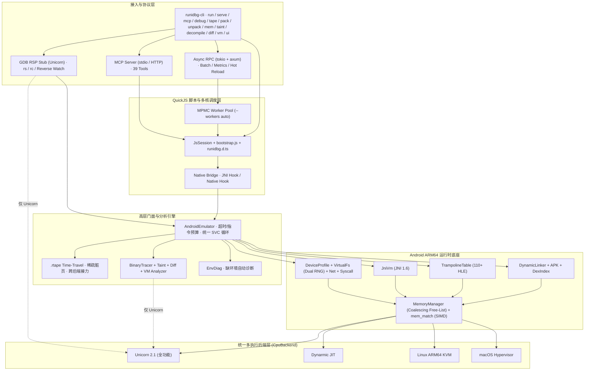

# runidbg 组件与工具完整使用指南

本文档涵盖 `runidbg` 全部 CLI 子命令、多执行后端、QuickJS 脚本 API、`good64` 零依赖 ARM64 汇编器与重定位器、设备画像（`DeviceProfile`）、零拷贝 Trace / HLE 统一流 / 离线污点切片 / 切片反编译伪 C / 全知查询 / 内存重建 / 双跑 Diff 污点联动 / VM 专项分析、`.rtape` 时间旅行调试、异步多核 RPC 服务、MCP 39 工具、GDB RSP 远程调试以及 Rust 库接口。

---

## 1. 命令行工具 `runidbg-cli`

全局日志选项需置于子命令之前：
```bash
runidbg-cli [--log-level <trace|debug|info|warn|error>] [--log-format <compact|json>] <subcommand> ...
```

| 子命令 | 用途 | 常用示例 |
| --- | --- | --- |
| `run` | 运行 QuickJS 仿真脚本（支持 `--freeze-layout` 隔离宿主分配） | `runidbg-cli run --freeze-layout probe.js -- "arg1"` |
| `serve` | 启动异步 HTTP / JSON-RPC 2.0 服务 | `runidbg-cli serve script.js --listen 0.0.0.0:8080 --workers auto --max-queue 2048 --timeout-ms 15000 --max-insns 5000000 --allow-reload` |
| `mcp` | 启动 MCP 服务端（stdio / Streamable HTTP，39 个工具） | `runidbg-cli mcp --cwd .` 或 `runidbg-cli mcp --http 127.0.0.1:8090 --cwd .` |
| `debug` | 启动 ARM64 GDB RSP 远程调试服务端（支持 `.so` 或 `--tape` 时间旅行反向调试） | `runidbg-cli debug --tape sign_tt.rtape --listen 127.0.0.1:1234` |
| `tape` | 查看 `.rtape` 磁带检查点、时间轴事件与压缩统计 | `runidbg-cli tape info ./sign_tt.rtape` |
| `asm` | 使用内置 `good64` 零依赖汇编器将 ARM64 汇编编译为机器码并反汇编校验 | `runidbg-cli asm "paciasp; ubfx x0, x1, #4, #8; ret" --pc 0x40001000` |
| `ui` | 启动内置暗黑 Web UI（Trace 分析 + `.rtape` 时间旅行驾驶舱） | `runidbg-cli ui ./trace.idx --base 0x40000000 --open` |
| `init-types` | 导出 TypeScript 类型声明 `runidbg.d.ts` | `runidbg-cli init-types examples/scripts` |
| `dump` | 离线反汇编 Trace（自动探测同级 `.ext`，含访存 R/W 与 HLE 事件） | `runidbg-cli dump trace.idx --base 0x40000000 --skip 0 --limit 50` |
| `search` / `find` | 离线检索寄存器值 / 访存地址 / PC / ASCII / 字节序列（支持 `--seq-range` / `--only-writes` / `--only-reads` / `--no-hle`） | `runidbg-cli find trace.idx --addr 0x50006470 --len 8 --seq-range 1000..50000 --only-writes` |
| `mem` | 离线重建任意 `--at <seq>` 时刻内存区间快照（支持 `--hexdump` / `--hex` / `--out file.bin`） | `runidbg-cli mem trace.idx --addr 0x50006170 --len 576 --at 1820000` |
| `taint` | 离线字节级前向污点传播与反向因果切片（跨 HLE `memcpy`/熵源标注，支持 `--from-seq` / `--stop-at-pc` / `--stop-mem`） | `runidbg-cli taint trace.idx --mode backward --addr 0x50006470 --len 8 --from-seq 1922597` |
| `decompile` | `decompile` v2：动态污点切片 → 单路径符号提升（支持 `1..=64`B 多输出联合反编译 + 跨输出 CSE、`LOAD16/32/64_LE`、`UMULH`/`SMULH`/`UBFIZ`/`SBFIZ`/`REV16`、NEON 128-bit 通道与 ARMv8-CE 硬件 AES `AESE`/`AESD`/`AESMC`/`AESIMC`）→ 代数/MBA/字节重装化简 + `--fold-rodata` → 自校验精简伪 C & `QF_BV`/`QF_UFBV` SMT-LIB2 | `runidbg-cli decompile trace.rtrace --addr 0x50006470 --len 16 --from-seq 1922597 --fold-rodata --fn round_fn --smt2` |
| `pack` | 将 `.idx` + 伴生 `.ext` 裁剪尾部零填充并 Deflate 压缩为带双层 CRC32 的单文件 `.rtrace` 归档（支持 `--base` / `--note` / `--level 0..9` / `--no-ext`；所有离线命令、UI、JS 与 MCP 均透明免解包直读 `.rtrace`） | `runidbg-cli pack trace.idx --base 0x40000000 --note "sign v2" --out trace.rtrace` |
| `unpack` | 查看 `.rtrace` 归档头/元信息（`--info`）或安全校验 CRC32 解包还原为 `.idx` / `.ext`（支持 `--out-dir` / `--stem` / `--force`） | `runidbg-cli unpack trace.rtrace --info` 或 `runidbg-cli unpack trace.rtrace --out-dir ./out` |
| `diff` | 双跑 Trace 差分（首次控制流/数据流分歧，或加 `--target-addr` 自动对差异字节段做反向污点联动溯源） | `runidbg-cli diff a.idx b.idx --target-addr 0x50006850 --len 32` |
| `vm` | OLLVM / 自定义字节码 VM 专项分析（自动识别调度循环、跳转表、opmap 步长与寄存器堆差分，支持 `--seq-range`） | `runidbg-cli vm trace.idx --seq-range 1821500..1824500 --base-reg x25 --layout 6:6,12,17,22,27` |
| `stats` | 离线热点统计（唯一 PC、Top-N 热点指令与 `BL` 目标；缺失伴生 `.ext` 时自动输出 `WARN`） | `runidbg-cli stats trace.idx --base 0x40000000 --top 20` |
| `calltree` | 离线时间轴调用树构建与热点函数耗时统计 | `runidbg-cli calltree trace.idx --base 0x40000000 --max-depth 5 --min-insns 1000` |
| `crypto-scan` | 离线密码学原语自动扫描（AES ARMv8-CE/S-Box / Simon-128 / TEA / RC4 / MD5 / SHA / SM3 / SM4 / ChaCha）+ 算法窗口候选 I/O 地址提取 | `runidbg-cli crypto-scan trace.idx --base 0x40000000` |
| `export-ida` | 导出 IDA Pro 执行覆盖率高亮脚本 | `runidbg-cli export-ida trace.idx --base 0x40000000 --out ida_cov.py` |
| `export-bn` | 导出 Binary Ninja 执行覆盖率高亮脚本 | `runidbg-cli export-bn trace.idx --base 0x40000000 --out bn_cov.py` |

---

## 2. QuickJS 脚本引擎 API

完整 TypeScript 声明见 [src/script/runidbg.d.ts](../src/script/runidbg.d.ts)。

### 2.1 创建模拟器、多后端、堆布局冻结与设备画像（`DeviceProfile`）
```javascript
const emu = Emu.create({
  backend: "unicorn",               // "unicorn"(全功能) | "dynarmic" | "kvm"(Linux) | "hypervisor"/"hyper"(macOS)
  packageName: "com.example.app",
  searchPaths: ["./libs"],          // DT_NEEDED 依赖搜索路径
  hleAccel: true,                   // 默认 true，开启高频 libc/libm HLE 加速
  freezeLayout: true,               // 开启后 emu.mem.alloc() 隔离到 [host-scratch]，绝不漂移 guest malloc 堆地址！
  heapSize: 32 * 1024 * 1024,       // 默认 32 MB
  realClock: false,                 // true=宿主机实时时间；false=确定性虚拟时钟（默认）
  device: {                         // 可直接传预设名 "pixel5" | "pixel8pro" | "s24ultra" | "xiaomi14"
    preset: "pixel8pro",
    model: "23049RAD8C",
    brand: "Redmi",
    sdkInt: 35,
    androidRelease: "15",
  },
});

// 随时查看 guest 堆布局指纹与关键分配点，排查跨跑地址变化：
console.log(JSON.stringify(emu.heapLayout(50), null, 2));
```
应用 `device` 后自动同步 30+ 项 Android 系统属性、`/proc/cpuinfo`、`/proc/meminfo`、`/proc/version`、`/sys/devices/system/cpu/online|possible`、`uname` 与 JNI `android/os/Build.*` 静态字段。

> **PRNG 桩说明**：HLE `rand()`/`random()`/`srand()`/`srandom()` 使用确定性 `xorshift64*` 实现（非真 glibc TYPE_3 状态机），首次触发会在日志打印一次提醒；如需自定义序列可用 `emu.hook.importReplace("rand", ...)` 替换。

### 2.2 加载 `.so` / APK、快照与 `.rtape` 时间旅行
```javascript
// 加载独立 .so（自动递归加载 DT_NEEDED、执行重定位与 .init_array）
const mod = emu.load("./libs/libtarget.so");
const ver = emu.jniOnLoad(mod);

// 或一键内存加载 APK（自动解析包名、ABI、assets 与签名）
const apk = emu.loadApk("./app.apk");
const lib = apk.loadLib("libtarget.so");

// 设置单次调用硬超时与指令预算（0 表示不限）
emu.setLimits({ timeoutMs: 15000, maxInstructions: 5_000_000 });

// 进程内内存快照回滚
const snapId = emu.snapshot();
const r1 = mod.call("sign", ptr1, len1);
emu.restore(snapId);
const r2 = mod.call("sign", ptr2, len2);

// 持久化 .rtape 磁带与跨后端接力（Dynarmic/Hypervisor 初始化 -> Unicorn 时间旅行）
emu.saveTape("./init.rtape", "after_init");
const uc = Emu.loadTape("./init.rtape", { backend: "unicorn", checkpoint: "after_init" });
uc.record.start({ keyframeInterval: 100000, captureJni: true });
uc.module("libtarget.so").call("sign", ptr1, len1);
uc.record.bookmark("done");
uc.record.stop("./sign_tt.rtape");

const tt = Emu.openTimeTravel("./sign_tt.rtape");
tt.verifyDeterminism();
tt.seekBookmark("done");
const writer = tt.findPrevWrite(ptr1, 8);
tt.close();
```

### 2.3 JNI 桥接与 Hook
```javascript
emu.jni.hook("com/example/Env", {
  getToken(arg0) { return "mock-token"; },
});
emu.jni.onUnhandled((info) => {
  console.log(info.kind, info.className, info.name, info.sig, info.args);
  return 0;
});

// 常驻 RPC 建议包裹在 withLocalFrame 中自动回收本地引用与临时缓冲
const out = emu.jni.withLocalFrame(() => {
  const cls = emu.jni.findClass("com/example/Api");
  const sRef = emu.jni.newString("payload");
  const ret = emu.call(mod.base + 0x120be0, emu.jni.envPtr, cls, sRef);
  return emu.jni.getStringArray(ret);
});
```

### 2.4 Frida 风格 Native Hook、无损 64-bit 寄存器与 Rust 侧内存过滤
> **重要时序与精度说明**：
> - **`emu.hook.code` 在目标指令执行前触发**，回调里读到的寄存器是该指令执行前的状态；
> - **`ctx.reg("x8")` 返回 JS `number`**，超过 `2^53 - 1` 会丢低位精度。读取 64 位整数/哈希/指针请使用 **`ctx.reg64("x8")`** 或 **`emu.regs.get64("x8")`**（返回无损 `BigInt`）。

```javascript
// 1. 函数入口/返回 Hook（this 可在 onEnter 与 onLeave 间共享状态）
const h1 = emu.hook.attach(mod.base + 0x12340, {
  onEnter(ctx) {
    this.x8 = ctx.reg64("x8"); // 无损 64-bit BigInt
    console.log("x0=", ctx.reg64("x0").toString(16), "str=", ctx.mem.readCString(ctx.x1, 128));
  },
  onLeave(ctx) {
    console.log("retval=", ctx.reg64("x0").toString(16));
  },
});

// 2. 函数替换 / 导入表替换
const h2 = emu.hook.replace(mod.base + 0x56780, (ctx) => 0);
const h3 = emu.hook.importReplace("rand", () => 0x1234);

// 3. 区间写/读监视（emu.hook.watch）与 Rust 侧零开销过滤（emu.hook.mem）
//    当目标区间尚无已映射页时，会输出警告并设置 handle.unmapped === true
const wh = emu.hook.watch([buf, buf + 64], "w", (ctx, access, addr, size, val, val64) => {
  console.log(`pc=0x${ctx.pc.toString(16)} write addr=0x${addr.toString(16)} val64=0x${val64.toString(16)}`);
});

const mh = emu.hook.mem(
  [buf, buf + 64],
  { write: true, value: 0xdeadbeefn, size: 4, pcRange: [mod.base, mod.base + mod.size], bigInt: true },
  (ctx, access, addr, size, val, val64) => { /* 仅在 Rust 侧条件全命中时进入 JS */ }
);
if (mh.unmapped) console.warn("目标区间尚未映射！");

// 4. 原生内存特征扫描与热修补（自动刷新 Unicorn TB 缓存）
const hits = emu.mem.scan(mod.base, mod.size, "FD 7B ?? A9");
emu.mem.nop(mod.base + 0x9000, 2);
emu.mem.ret(mod.base + 0x9100, 1);
```

### 2.5 VM 专项辅助（在线 `emu.vm` + 离线 `Trace.open().vmAnalyze`）
```javascript
// 在线实时监听自定义字节码 VM 寄存器堆（自动追踪 baseReg 栈帧搬家 + 解码字节码指令字 + 统计步长）
const watcher = emu.vm.watchRegfile({
  baseReg: "x25",
  count: 32,
  size: 8,
  dispatcherPc: mod.base + 0x12340,
  bcReg: "x23",      // 若 [x23] 内存里存着字节码指针，加 bcDeref: true
  wordSize: 4,
  layout: { op: [6, 6], fields: [12, 17, 22, 27] },
});
emu.call(mod.base + 0x10000, ...);
console.log(watcher.format(100)); // step#0001 bc=0x...(+8B) op=49 f=[1,5,0,7] | R[3]: 0x10->0x42
console.log(watcher.stats());     // 按 op 汇总频次与消费字节步长直方图
watcher.detach();

// 单独解码任意字节码指令字（支持 64-bit 无损 BigInt）：
const dec = emu.vm.decodeWord(0x38005c40, { op: [6, 6], fields: [12, 17, 22, 27] });
```

### 2.6 缺环境诊断（`EnvDiag`）与崩溃报告（`CrashReport`）
```javascript
emu.diag.enable();
console.log(JSON.stringify(emu.diag.report(), null, 2));
console.log(emu.diag.generatePatchJs());

const crash = emu.lastCrash();
if (crash) console.error(crash.formatted);
```

---

## 3. 高性能二进制 Trace、离线污点切片与全知查询

| 级别 | 记录内容 | 实测吞吐 | 适用场景 |
| --- | --- | ---: | --- |
| `fast` | PC + 32-bit opcode（32B/条，无 `.ext`） | ~17 M insns/s | 覆盖率统计、IDA/BN 高亮、控制流路径对比 |
| `reg_delta` | 指令 + 变更寄存器增量（32B/条，无内存 `.ext`） | ~5 M insns/s | 轻量算法逆向、寄存器值溯源 |
| `full` | `reg_delta` + `.ext`（访存 R/W + HLE `memcpy`/`memmove`/`memset`/`bzero`/`malloc`/`calloc`/`realloc`/`free` + `rand`/`getrandom`/`gettimeofday`/`clock_gettime`/`time` 熵源与时钟源） | ~4.7 M insns/s | 离线污点与反向因果切片、切片反编译、全知值/地址查询、内存重建、VM 离线分析 |

- 默认容量为 `262144` 条指令（`.ext` 双倍容量）；容量耗尽时会在 `emu.trace.stop()` 打印截断警告并返回 `stats.truncated === true` 与 `droppedInsns`/`droppedExt`。若 `full` 级 `.idx` 丢失伴生 `.ext`，所有离线 CLI / JS / MCP 命令均会给出显式告警。
- QuickJS 离线 `Trace.open()` API：
```javascript
const tr = Trace.open("trace_full.idx"); // 自动关联同级 .ext，含 missingExtWarning / recordedLevel
const wHits = tr.findWrites(0xdeadbeefn, { width: 4 }); // 每条命中含无损 BigInt value64
const aHist = tr.findMem(0x50006470, { kind: "w", len: 8, minSeq: 1000, maxSeq: 50000, includeHle: false });
const hles  = tr.hleEvents(200);
const snap  = tr.reconstructMem(0x50006470, 16); // snap.bytes 为 Uint8Array，可省略第 3 参 atSeq
const bwd   = tr.taintBackward({ addr: 0x50006470, len: 8, fromIdx: 1000, stopAtPcs: [0x40001200] });
const cRep  = tr.taintToC({ addr: 0x50006470, len: 8, fromIdx: 1000, foldRodata: true, emitSmt2: true });
const fwd   = tr.taintForward({ addr: 0x50001000, len: 16 });
const vmRep = tr.vmAnalyze({ minIdx: 1821500, maxIdx: 1824500, baseReg: "x25", layout: { op: [6, 6], fields: [12, 17, 22, 27] } });
tr.close();

const diff      = Trace.diff("run_a.idx", "run_b.idx", 100);
const diffTaint = Trace.diffTaint("run_a.idx", "run_b.idx", 0x50006850, 32);
```

---

## 4. 异步多核 RPC 服务（`runidbg-cli serve`）

| 端点 | 方法 | 说明 |
| --- | --- | --- |
| `/health` | `GET` | 健康状态、Worker 数、队列占用、热重载版本、导出方法列表 |
| `/metrics` | `GET` | 运行指标（加 `?format=prom` 输出 Prometheus 文本格式） |
| `/exports` | `GET` | 列出 `rpc.exports` 全部导出方法 |
| `/call/<method>` | `POST` | 直接调用方法，Body 为 JSON 参数数组 `[arg0, arg1, ...]` |
| `/rpc` | `POST` | 标准 JSON-RPC 2.0（支持单条与 Batch 数组多核并行） |
| `/admin/reload` | `POST` | 先校验新脚本再原子滚动重建 Worker 池（需 `--allow-reload`） |
| `/eval` | `POST` | 动态执行 JS 表达式（需 `--allow-eval`） |

背压与熔断：队列满返回 `HTTP 503`；超出 `--timeout-ms` 或 `--max-insns` 触发硬中断并返回 `HTTP 504`。

---

## 5. MCP 服务端（39 个 AI 逆向工具）

支持 **stdio**（`runidbg-cli mcp --cwd .`）与 **Streamable HTTP**（`runidbg-cli mcp --http 127.0.0.1:8090 --cwd .`）：

| 类别 | 工具名 | 说明 |
| --- | --- | --- |
| 生命周期与执行 | `emu_create` / `emu_load` / `emu_jni_onload` / `emu_exports` / `emu_call` / `emu_eval_js` | 创建实例（支持 `backend`/`freezeLayout`）、加载 `.so`、查导出、调函数与执行 JS |
| DEX 与 JNI | `emu_load_dex` / `emu_dex_class_info` / `emu_jni_set_field` / `emu_jni_call_native` | 加载 DEX 元数据索引、查询类/字段/方法、读写 JNI 字段与直接调用原生方法 |
| 状态、汇编与反汇编 | `emu_regs` / `emu_mem_read` / `emu_mem_scan` / `emu_disasm` / `emu_asm` | 读寄存器、读/扫内存、`bad64` 反汇编、`good64` 现场汇编与内存 Patch |
| Trace / 污点 / 伪 C / 内存 / Diff / VM / Hook | `emu_trace_call` / `trace_inspect` / `trace_calltree` / `trace_crypto_scan` / `trace_taint` / `trace_decompile` / `trace_mem` / `trace_query` / `trace_diff` / `trace_vm_analyze` / `emu_hook_capture` | 函数级 Trace、检索、调用树、密码学扫描（含 I/O 窗口）、离线污点切片、动态切片反编译伪 C/SMT2、任意时刻内存重建、全知查询、双跑差分（含 `targetAddr` 污点联动）、VM 自动分析与一次性 Hook 抓取 |
| `.rtape` 磁带与时间旅行 | `emu_save_tape` / `emu_load_tape` / `emu_seek_tape` / `tape_info` / `tt_record_start` / `tt_record_stop` / `tt_open` / `tt_seek` / `tt_reverse_watch` / `tt_mem_read` / `tt_close` | 跨后端磁带接力、二期时间旅行录制、任意指令跳转与反向内存写/读/访问观察点 |
| 诊断 | `emu_diag_missing` / `emu_last_crash` | 获取 `EnvDiag` 缺失环境报告与最新崩溃现场 |

客户端配置示例（Claude Desktop / Cursor / Codex stdio 模式）：

```json
{
  "mcpServers": {
    "runidbg": {
      "command": "/path/to/runidbg-cli",
      "args": ["mcp", "--cwd", "/path/to/workspace"]
    }
  }
}
```

---

## 6. GDB RSP 远程调试（含时间旅行反向调试）

```bash
# 普通 .so 调试
runidbg-cli debug samples/libstatic-webp.so WebPGetDecoderVersion --listen 127.0.0.1:1234

# .rtape 磁带时间旅行反向调试（支持 rs / rc / watch / rwatch / awatch / monitor seek / monitor rw）
runidbg-cli debug --tape ./sign_tt.rtape --listen 127.0.0.1:1234
```
支持标准 ARM64 GDB Remote Serial Protocol，可直接用 `gdb-multiarch` / `pwndbg` / IDA Pro / Binary Ninja 连接：`target remote 127.0.0.1:1234`。

---

## 7. Rust 库嵌入用法

```rust
use runidbg_arm64_emu_tracer::os::DeviceProfile;
use runidbg_arm64_emu_tracer::tracer::{
    TaintOptions, TaintSeed, TraceLevel, TraceReader, VmAnalysisOptions,
};
use runidbg_arm64_emu_tracer::AndroidEmulator;

let mut emu = AndroidEmulator::builder()
    .package_name("com.example.app")
    .device_profile(DeviceProfile::pixel_8_pro())
    .add_search_path("./libs")
    .with_memory_trace(200_000, TraceLevel::Full)
    .build()?;

let module = emu.load_library("./libs/libtarget.so")?;
emu.call_jni_onload(&module)?;
let ret = emu.call_symbol(&module, "target_func", &[0, 0])?;

// 离线污点切片与 VM 专项分析同样可直接从 Rust 调用：
let reader = TraceReader::open("trace.idx", Some(std::path::Path::new("trace.ext")))?;
let bwd = reader.taint_backward(&TaintSeed::Mem { addr: 0x5000_6470, len: 8 }, &TaintOptions::default());
let vm  = reader.analyze_vm(&VmAnalysisOptions::default());
```

---

## 8. 源码构建、Feature 开关与多后端选型

### 8.1 原生构建依赖

因为默认 Feature 包含 `dynarmic`（ARM64 JIT 后端），从源码执行 `cargo build --release --bin runidbg-cli` 前请先安装对应平台的原生构建工具：

- **macOS (Apple Silicon)**：`brew install pkgconf cmake ninja`
  - 本机源码构建后若需启用 `hypervisor` 后端，须对产物进行 ad-hoc entitlement 签名（GitHub Release 产物已预签）：
    ```bash
    codesign --force --sign - --entitlements entitlements/hypervisor.plist target/release/runidbg-cli
    ```
- **Linux (`x86_64` / `aarch64`)**：`sudo apt-get install -y build-essential pkg-config cmake ninja-build clang libclang-dev`
- **Windows (`x86_64` MSVC)**：安装 Visual Studio C++ Build Tools、`cmake`、`ninja` 与 LLVM（设置 `LIBCLANG_PATH`）

### 8.2 Feature 开关

| Feature | 默认启用 | 说明 |
| --- | :---: | --- |
| `js` | ✅ | QuickJS 脚本引擎（`rquickjs`） |
| `rpc` | ✅ | 异步多核 HTTP / JSON-RPC 2.0 服务（`tokio`、`axum`、`async-channel`、`serde_json`） |
| `mcp` | ✅ | MCP stdio / Streamable HTTP 服务端（39 个 AI 逆向工具） |
| `apk` | ✅ | APK 一键解析与内存加载（`zip`） |
| `ui` | ✅ | 内置暗黑 Web UI（Trace / 时间旅行驾驶舱 / RPC / EnvDiag） |
| `dynarmic` | ✅ | 跨平台 Dynarmic ARM64 JIT 加速后端（**仅仿真模式**，构建需 `cmake` + `ninja`） |
| `kvm` | ✅（Linux） | Linux ARM64 `/dev/kvm` 硬件虚拟化后端（**仅仿真模式**，仅在 Linux 编译） |
| `hypervisor` | ✅（macOS） | macOS Apple Silicon `Hypervisor.framework` 后端（**仅仿真模式**，仅在 macOS 编译） |

- **纯 Unicorn 最小核心构建**（零 JS / HTTP / ZIP / Dynarmic 依赖，仍保留 Unicorn 仿真、DeviceProfile、Tracer、EnvDiag 与 GDB Stub）：
  ```bash
  cargo build --no-default-features
  ```

### 8.3 多后端选型建议

- **逆向分析 / 指令 Trace / GDB 调试 / 原生指令与内存 Hook** → 必须选择 **`unicorn`**（其余后端仅限仿真模式，调用上述接口会立即返回明确错误）。
- **高吞吐算法计算 / 批量离线签名 / 多核 RPC 生产服务** → 优先选择 **`dynarmic`**（无签名限制、支持单进程无限多 Worker 并发）或硬件虚拟化 **`hypervisor`**（macOS Apple Silicon，需 `com.apple.security.hypervisor` 签名，单进程限 1 VM）/ **`kvm`**（Linux ARM64 `/dev/kvm`，支持单进程多 VM）。

---

## 9. 完整性能基准与 Java `unidbg` 对比

### 9.1 测试口径与与 `unidbg` 实测数据

> Apple Silicon（10 核 ARM64 macOS），JDK 21（`unidbg 0.9.9`）vs `runidbg-cli --release`。样本为同一份 ~2 MB stripped Android ARM64 安全签名 `.so`（含 `libc++_shared.so`），两边 100% 产出完全一致的有效签名结果。

| 评测项 | Java `unidbg` | Rust `runidbg` | 提升 |
| --- | ---: | ---: | :---: |
| 环境初始化 + ELF 加载 | 1,666 ms | **40 ms** | **41.7×** |
| `JNI_OnLoad` | 72 ms | **37 ms** | **1.9×** |
| **总冷启动耗时** | 1,738 ms | **77 ms** | **22.6×** |
| 进程内单核热态调用（50 次均值） | 3.80 ms (263.4 QPS) | **1.30 ms (769.2 QPS)** | **2.92×** |
| HTTP RPC（1 worker，100/100 校验） | 254.7 QPS · 122.1 MB | **628.7 QPS · 21.7 MB** | **2.47× · 省 82% 内存** |
| HTTP RPC（`--workers auto=10`，200/200 校验） | 254.7 QPS · 122.1 MB | **1,141.0 QPS · 127.5 MB** | **4.48× · 10 实例 ≈ 1 JVM** |
| 全模块指令 Trace（`fast` mmap） | 0.149 M insns/s (1,851 ms) | **17.03 M insns/s (64 ms)** | **114×** |
| 全模块指令 Trace（`reg_delta`） | 0.149 M insns/s | **5.14 M insns/s (212 ms)** | **34.5×** |
| 全模块指令 Trace（`full` + 20.1 万内存/HLE） | 0.149 M insns/s | **4.68 M insns/s (233 ms)** | **31.4×** |

### 9.2 多执行后端加速比（同一 `runidbg-cli` · 100% 比特级一致输出）

> Apple Silicon M4（Unicorn / Dynarmic / Hypervisor.framework）与 Ubuntu 26.04 Linux 7.0 `aarch64`（M4 嵌套虚拟化 `/dev/kvm`）实测：

| 场景 | Unicorn | Dynarmic (JIT) | Hypervisor (macOS M4) | KVM (Linux ARM64 嵌套) | 峰值加速 |
| --- | ---: | ---: | ---: | ---: | :---: |
| **ZSTD 256KB lv6 × 20 轮**（重纯算 / NEON） | 24,964 ms | 245 ms (`102×`) | **52 ms (`480×`)** | 105 ms (`192×`) | **480×** |
| **ZSTD 26.4KB lv3 × 100 轮**（轻纯算 / 高频） | 493 ms | **10 ms (`49×`)** | 14 ms (`35×`) | 113 ms (`8.3×`) | **49×** |
| **TikTok `libmetasec_ov.so` 10× 签名**（重 HLE/JNI） | 398 ms | 76 ms (`5.2×`) | **37 ms (`10.8×`)** | 623 ms（裸机 ~30–40 ms） | **10.8×** |

### 9.3 与 Java `unidbg` 的客观对比

| 维度 | `runidbg` | Java `unidbg` |
| --- | --- | --- |
| **运行性能与内存** | 原生 Rust + 四执行引擎，冷启动快 **22.6×**、纯算最高 **480×**、单实例内存仅 **1/5.6** | JVM + JNI/JNA 跨边界开销，冷启动 ~1.7 s，单实例 ~122 MB |
| **Trace 与离线分析** | 零拷贝 mmap 双流（含 HLE 事件）、纯 Rust 字节级污点/因果切片、SIMD 扫描、Trace Diff、VM 助手、`.rtape` 时间旅行反向调试 | 热路径实时 Capstone 文本落盘（~0.15M/s），进阶分析需二次开发 |
| **脚本与工程化** | 零编译 QuickJS + `runidbg.d.ts`、原生内置多核 RPC / `/metrics` / Web UI / 39 工具 MCP / `EnvDiag` | 需维护 Maven/JDK 工程并编译运行，服务端池化与 AI 集成需自行封装 |
| **平台与架构** | **目前专注 Android ARM64（`aarch64`）**，暂不支持 ARM32 与 iOS | 支持 **Android ARM32 / ARM64 以及 iOS（Mach-O / ObjC）** |
| **社区成熟度** | 项目较新，已验证 Cronet / Conscrypt / MMKV / SQLite / WebP / Zstd / MSSDK，长尾系统库持续完善中 | 多年社区沉淀，公开案例、教程与边缘系统类桩极其丰富 |

---

## 10. 系统架构与源码目录



```text
src/
├── emulator.rs                 # AndroidEmulator 门面与统一外部 SVC 陷阱循环
├── backend/                    # CpuBackend / Dynarmic / KVM / Hypervisor.framework
├── loader/                     # ELF 动态链接器、APK/DEX 加载与 HLE Trampoline
├── os/                         # DeviceProfile、SVC 系统调用、VFS（隔离双流 RNG）、Socket/Net
├── jni/                        # JNI 1.6 环境、对象表、LocalFrame、va_list 与 Hook
├── memory.rs                   # VMA 虚拟内存与 Coalescing Free-List 堆分配器
├── mem_match.rs                # 零依赖 SIMD 通配符扫描器与 4KB 页块影子内存
├── snapshot.rs / tape.rs       # 内存快照与 .rtape 多检查点稀疏脏页格式
├── timetravel.rs               # 时间旅行引擎（EventLogBus / 关键帧缓存 / 反向观察点）
├── tracer/                     # mmap 双流 Tracer、全知查询/Diff、字节级污点切片、VM 分析器
├── debug/gdbstub.rs            # ARM64 GDB RSP 远程调试服务端
├── diag.rs / crash.rs          # EnvDiag 缺环境自动诊断与 Guest 崩溃现场反汇编报告
├── ui/                         # 内置暗黑 Web UI（Trace / 时间旅行 / RPC / EnvDiag）
├── script/                     # QuickJS 桥接、Hook、runidbg.d.ts、多核 RPC 与 39 工具 MCP
└── bin/runidbg-cli.rs          # 统一命令行入口
```
